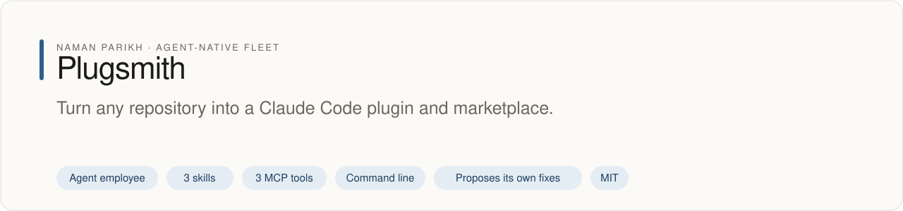

# Plugsmith

<!-- fleet:header:start -->
<p align="center"><picture><source media="(prefers-color-scheme: dark)" srcset="assets/banner-dark.svg"></picture></p>

<p align="center">
<a href="https://github.com/naman10parikh/plugsmith/actions/workflows/ci.yml"></a>
<a href="https://github.com/naman10parikh/plugsmith/releases"></a>
<a href="LICENSE"></a>
<a href="#use-it-from-any-coding-agent"></a>
<a href="https://x.com/naman10parikh"></a>
<a href="https://www.linkedin.com/in/naman-parikh1/"></a>
</p>

<p align="center"><a href="#quick-start">Quick start</a> · <a href="https://naman10parikh.github.io/plugsmith/">Website</a> · <a href="docs/README.md">How it works</a> · <a href="AGENTS.md">AGENTS.md</a> · <a href="llms.txt">llms.txt</a> · <a href="skills/">Skills</a> · <a href="https://github.com/naman10parikh/plugsmith/discussions">Discussions</a> · <a href="https://github.com/naman10parikh">All projects</a></p>

**Turn any repository into a Claude Code plugin and marketplace.**

Plugsmith is an agent employee, a packaged specialist agent with its own skills, memory and tests. It owns one job: plugins. Coding agents use it through its skills, its MCP server and its command line. A scheduled job runs its evals and proposes fixes. A person makes every change.

_Plugsmith is part of an agent-native play for agent-native systems that can eventually be recursively self-improving and evolving, operated by agent employees._

<p align="center"></p>
<!-- fleet:header:end -->

Plugsmith turns any repository with skills, agents, commands, hooks or MCP servers into a Claude Code plugin. It
writes `.claude-plugin/plugin.json` and a one-plugin `marketplace.json`, so anyone installs the repo with two
`/plugin` lines, and it checks the result the way Claude Code's own validator does. It is for anyone who built a
harness in a repository and wants others to install it in one step.

<!-- fleet:use:start -->
## Use it from any coding agent

**Claude Code**: the plugin brings the skills, sub-agents, hooks and MCP server.

```
/plugin marketplace add naman10parikh/plugsmith
/plugin install plugsmith@plugsmith
```

<details><summary>Its MCP server, Codex, Cursor, Gemini CLI, one skill and the command line</summary>

**Its MCP server**, in any MCP client:

```bash
claude mcp add --transport stdio plugsmith -- npx -y -p github:naman10parikh/plugsmith plugsmith-mcp
codex mcp add plugsmith -- npx -y -p github:naman10parikh/plugsmith plugsmith-mcp
```

Cursor (`.cursor/mcp.json`), Gemini CLI (`.gemini/settings.json`) and most other clients take the same command as JSON:

```json
{
  "mcpServers": {
    "plugsmith": {
      "command": "npx",
      "args": [
        "-y",
        "-p",
        "github:naman10parikh/plugsmith",
        "plugsmith-mcp"
      ]
    }
  }
}
```

**Gemini CLI**: the extension brings the context and the MCP server.

```bash
gemini extensions install https://github.com/naman10parikh/plugsmith
```

**One skill** (3 in all, in [skills/](skills/)), in any agent that reads Agent Skills:

```bash
gemini skills install https://github.com/naman10parikh/plugsmith --path skills/build-plugin
git clone --depth 1 https://github.com/naman10parikh/plugsmith /tmp/plugsmith && cp -r /tmp/plugsmith/skills/build-plugin ~/.claude/skills/
```

**The command line:**

```bash
npx -y -p github:naman10parikh/plugsmith plugsmith --help
```

</details>

Codex, Cursor, OpenCode, GitHub Copilot and other agents read [AGENTS.md](AGENTS.md); Claude Code reads [CLAUDE.md](CLAUDE.md) and Gemini CLI reads [GEMINI.md](GEMINI.md), which import it. [llms.txt](llms.txt) maps every surface for agents that read first.
<!-- fleet:use:end -->

## Quick start

It installs from GitHub; nothing is published to npm. In the repository you want to package:

```bash
npx -y -p github:naman10parikh/plugsmith plugsmith .          # writes .claude-plugin/plugin.json + marketplace.json
npx -y -p github:naman10parikh/plugsmith plugsmith validate . --claude
```

Then, in Claude Code, anyone can install it:

```
/plugin marketplace add <owner>/<repo>
/plugin install <name>@<name>
```

On the bundled test repository:

```bash
git clone https://github.com/naman10parikh/plugsmith && cd plugsmith
pnpm install && pnpm build
pnpm test && pnpm eval                                     # unit tests, then the golden cases
node dist/src/cli.js fixtures/energy-fixture
# wrote manifest.json, plugin.json, marketplace.json
#   name: energy-fixture @ 0.2.0 · skills: 2 · commands: 1 · hooks: 2 · mcp: 2
# [plugsmith] check: valid
node dist/src/cli.js validate fixtures/energy-fixture --claude
# claude plugin validate: passed
```

With `E2B_API_KEY` set, `plugsmith validate . --sandbox=e2b` uploads only the files git tracks to a fresh E2B
microVM, installs Claude Code there and validates that copy. A plugin that leans on an ignored `dist/` or an
untracked script passes on your machine and fails there.

## How it works

```
any-repo/                                   any-repo/.claude-plugin/
  skills/review/SKILL.md                      plugin.json       ← what Claude Code reads
  .claude/skills/deep-think/SKILL.md   →      marketplace.json  ← one plugin, "source": "./"
  .claude/agents/reviewer.md                  manifest.json     ← plugsmith's inventory, for catalogs
  .claude/commands/status.md
  hooks/hooks.json
  .mcp.json
```

One owned artifact: `src/builder.ts`, the scanner and emitter. It:

1. Reads `skills/*/SKILL.md` and `.claude/skills/*/SKILL.md`: name, description, triggers
2. Reads `.claude/commands/*.md` and `.claude/agents/*.md`
3. Reads `hooks/` and `.mcp.json`
4. Writes `plugin.json` and `marketplace.json` in Claude Code's shape (`src/claude.ts`) and the inventory

Rules it follows, from Claude Code's plugin and marketplace references:

- `name` is the only required key; names that start with `claude-` or `anthropic-` are reserved
- every component path starts with `./`, stays inside the plugin and exists
- `agents` and `commands` replace their default folders, so agent files are listed one by one; `skills` adds
  to `skills/`; `hooks/hooks.json` and `.mcp.json` load without a key
- `marketplace.json` needs `name`, `owner.name` and plugin entries with a `./` source; names such as
  `agent-skills` and `github` are reserved

An existing `plugin.json` or `marketplace.json` is kept unless you pass `--force` (the old plugsmith catalog
format is always replaced). Warnings name what would break for a stranger: an MCP server on a relative path,
hooks that live only in `.claude/settings.json`, a missing author. No LLM calls; the only network use is the
optional clean room.

## Test

```bash
pnpm test     # 43 vitest cases: the energy-fixture build, name rules, the validator, keep-or-replace, the clean room
pnpm eval     # 8 golden repositories; 6 are also checked against claude plugin validate when it is on PATH
```

Every night `.github/workflows/improve.yml` runs the tests and the golden eval against Claude Code's validator and
compares the `plugin.json` keys plugsmith knows with Claude Code's manifest reference. The two reserved-name
cases skip the Claude Code check: its reserved-name check fired on a developer machine but not on the CI runner,
with the same version, so plugsmith follows the documented rule there. When the reference changes,
it opens an issue with the change to make; a person reviews and merges it.

## See Also

- [Armory](https://github.com/naman10parikh/armory): the catalog that reads plugsmith's inventory
- [Darwin](https://github.com/naman10parikh/darwin): the self-improvement harness that improves these
- [hooksmith](https://github.com/naman10parikh/hooksmith): writes and fire-tests the hooks a plugin ships

<!-- fleet:anatomy:start -->
## What it is made of

Every project in this fleet is graded on the same 11 harness components and on self-improvement. Each mark is backed by a file you can open.

| Component | Grade | Where |
| --- | --- | --- |
| Identity | ✅ | identity/SOUL.md:3 |
| Memory | ✅ | identity/LEARNINGS.md:1 · src/recall.ts:66 (recall) |
| Skills | ✅ | skills/ (3 own skills) |
| Tools/CLIs | ✅ | package.json:21-22 (plugsmith, plugsmith-mcp) |
| Hooks | ✅ | .claude/settings.json:9 · hooks/plugin-guard.mjs:1 |
| Sub-agents | ✅ | .claude/agents/manifest-reviewer.md:2 · plugin-packager.md:2 |
| MCPs | ✅ | src/mcp-server.ts:167 (3 tools) |
| Dispatch | ✅ | .github/workflows/improve.yml:7 (nightly) |
| Evals | ✅ | evals/run.mjs:1 · .github/workflows/ci.yml:24 |
| Observability | ✅ | src/run-log.ts:47 (run log) |
| Sandbox/Infra | ✅ | src/sandbox.ts:58 (E2B microVM) |
| Self-improvement | ✅ | dsip.json:2 · scripts/field-drift.mjs:1 (honest L2) |

✅ real and tested · 🟡 partial, with the reason in the row · ❌ absent
<!-- fleet:anatomy:end -->

<!-- fleet:footer:start -->
## How it improves itself

It carries its own evals and a self-improvement contract, [`dsip.json`](dsip.json), which says what it may change and how a change is judged. A scheduled job runs its evals and proposes fixes. A person makes every change. Lessons it learns are kept as rules in its memory files.

## Part of a fleet

One of the projects by [Naman Parikh](https://github.com/naman10parikh). Each owns one part of an agent's harness, or of the product around an agent, and all of them follow one standard.

| Related project | What it owns |
| --- | --- |
| [AgentDial](https://github.com/naman10parikh/agentdial) | Identity |
| [WikiMem](https://github.com/naman10parikh/wikimem) | Memory |
| [Skillsmith](https://github.com/naman10parikh/skillsmith) | Skills |
| [Agent Booster](https://github.com/naman10parikh/agent-booster) | Tools / CLIs |
| [Hooksmith](https://github.com/naman10parikh/hooksmith) | Hooks |
| [AgentCast](https://github.com/naman10parikh/agentcast) | Sub-agents |
| [Armory](https://github.com/naman10parikh/armory) | MCPs and the component registry |
| [AgentGrid](https://github.com/naman10parikh/agentgrid) | Dispatch |
| [AgentSwarm](https://github.com/naman10parikh/agentswarm) | Dispatch |
| [AgentBench](https://github.com/naman10parikh/agentbench) | Evals |
| [AgentMoney](https://github.com/naman10parikh/agentmoney) | Observability |
| [Sandforge](https://github.com/naman10parikh/sandforge) | Sandbox / Infra |
| [Claude Harness](https://github.com/naman10parikh/claude-harness) | The whole harness, as a template |

## Community

Questions and ideas go to [Discussions](https://github.com/naman10parikh/plugsmith/discussions); bugs go to [issues](https://github.com/naman10parikh/plugsmith/issues/new/choose). Follow the work on [X](https://x.com/naman10parikh) and [LinkedIn](https://www.linkedin.com/in/naman-parikh1/).

## Contributing and security

Read [CONTRIBUTING.md](CONTRIBUTING.md). AI-assisted pull requests are welcome. Report a vulnerability privately, as [SECURITY.md](SECURITY.md) explains.

## License

MIT, © 2026 Naman Parikh. See [LICENSE](LICENSE) and [NOTICE](NOTICE).

## Star history

If it is useful to you, a star helps other people find it.

<a href="https://star-history.com/#naman10parikh/plugsmith&Date"><picture><source media="(prefers-color-scheme: dark)" srcset="https://api.star-history.com/svg?repos=naman10parikh/plugsmith&type=Date&theme=dark"></picture></a>

## Contributors

<a href="https://github.com/naman10parikh/plugsmith/graphs/contributors"></a>
<!-- fleet:footer:end -->
