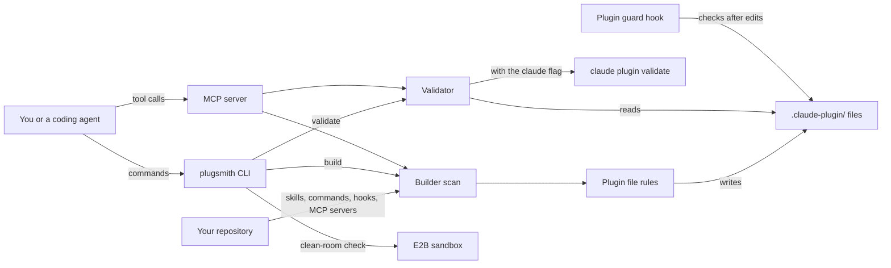

# How Plugsmith works

Plugsmith turns a repository into a Claude Code plugin with its own one-plugin marketplace.
A plugin is a folder Claude Code can install, described by `.claude-plugin/plugin.json`.
A marketplace is a `marketplace.json` file that lists plugins, so people can add a repository and install from it.
Plugsmith scans the skills, commands, agents, hooks and MCP servers a repository already has, writes both files, and checks them.
It is for people who maintain agent tools and want them installable in one step.

## The parts

The CLI is [src/cli.ts](../src/cli.ts).
[src/builder.ts](../src/builder.ts) scans a repository for skills, commands, hooks and MCP servers.
[src/claude.ts](../src/claude.ts) turns that scan into the two files Claude Code reads, following its plugin rules.
For example, component paths start with `./`.
Listing `commands` or `agents` replaces their default folders, so the builder lists the defaults too.
The builder also writes `manifest.json`, an inventory of every surface that Claude Code itself ignores.

[src/validate.ts](../src/validate.ts) checks the files the way Claude Code would, and `--claude` also runs the real `claude plugin validate`.
[src/sandbox.ts](../src/sandbox.ts) uploads only the files git tracks to an E2B sandbox, a short-lived virtual machine.
It installs Claude Code there and validates that copy, so it catches a plugin that needs a file a stranger would not get.
[src/mcp-server.ts](../src/mcp-server.ts) offers `build_plugin`, `validate_plugin` and `validate_manifest` over MCP, the Model Context Protocol that agents use to call tools.
The plugin hook [hooks/plugin-guard.mjs](../hooks/plugin-guard.mjs) checks a plugin file right after an agent edits it.
[src/run-log.ts](../src/run-log.ts) appends each build to `logs/build-runs.jsonl`.

## What happens when you run it

The main flow is `plugsmith <repo>`, then two commands inside Claude Code.

1. [src/cli.ts](../src/cli.ts) resolves the repository path and calls `buildPlugin` in [src/builder.ts](../src/builder.ts).
2. The builder scans `skills/` and `.claude/skills/` for folders with a `SKILL.md` or `README.md`. It also reads `.claude/commands/`, the scripts in `hooks/` and the servers in `.mcp.json`. It warns when it finds none of these.
3. It takes the name, version and description from `package.json`. It falls back to the folder name and the first line of the README.
4. [src/claude.ts](../src/claude.ts) derives `plugin.json` and `marketplace.json`. The author comes from `package.json`, without the email. With no author, the marketplace owner is written as "unknown" and a warning tells you to set one.
5. It writes `plugin.json`, `marketplace.json` and `manifest.json` into `.claude-plugin/`. An existing `plugin.json` or `marketplace.json` is kept unless you pass `--force`. With `--dry`, nothing is written.
6. [src/run-log.ts](../src/run-log.ts) appends a line to `logs/build-runs.jsonl`.
7. The CLI runs [src/validate.ts](../src/validate.ts) on the result. It checks required and reserved names, `./` paths that exist, agent files ending in `.md`, skill entries that are folders, and the marketplace entry. It exits with code 1 if the plugin is invalid.
8. In Claude Code you run `/plugin marketplace add <owner>/<repo>`, then `/plugin install <name>@<name>`.

## Extending it

- **A new surface to scan.** Add a scanner to [src/builder.ts](../src/builder.ts) and its type to [src/types.ts](../src/types.ts). If Claude Code needs it listed in `plugin.json`, add it to `deriveClaudeFiles` in [src/claude.ts](../src/claude.ts).
- **A new validation rule.** Add it to `validatePlugin` in [src/validate.ts](../src/validate.ts). Add a tiny repository as a case in [evals/golden.json](../evals/golden.json) with the verdict Claude Code gives.
- **A new plugin field.** Add the key to `KNOWN_PLUGIN_FIELDS` in [src/validate.ts](../src/validate.ts), or plugsmith warns that Claude Code ignores it.
- **A new reserved name.** Update `reservedPluginName` or `RESERVED_MARKETPLACE_NAMES` in [src/claude.ts](../src/claude.ts).
- **A new MCP tool.** Add it to the tool list and the call handler in [src/mcp-server.ts](../src/mcp-server.ts). Add a call to [scripts/mcp-smoke.mjs](../scripts/mcp-smoke.mjs).
- **Tests.** Unit tests live in [tests/builder.test.ts](../tests/builder.test.ts) and [tests/claude.test.ts](../tests/claude.test.ts). A sample repository to scan lives in [fixtures/](../fixtures/).

Then run `pnpm build`, `pnpm test`, `pnpm eval` and `node scripts/mcp-smoke.mjs`.

## Questions

**Does it need an API key or cost money?**
Plugsmith is free and MIT licensed.
Building and validating call no model, use no network and need no key.
`validate --claude` needs Claude Code installed.
`validate --sandbox=e2b` needs `E2B_API_KEY` and the optional `e2b` package, and E2B is a paid service.

**Does any data leave the machine?**
Building and validating stay on your machine.
`validate --sandbox=e2b` uploads the files git tracks, up to 2,000 files and 20 MB, to an E2B sandbox.
It installs Claude Code there, and the sandbox is always deleted afterwards.

**How does it improve itself?**
[dsip.json](../dsip.json) names no level.
It lists the steps review, extract, prioritize, validate and ship, and one outside source: Claude Code's plugin reference.
Every night [.github/workflows/improve.yml](../.github/workflows/improve.yml) builds, runs the tests and installs Claude Code.
It runs the golden evals, so `claude plugin validate` must agree with every case.
Then [scripts/field-drift.mjs](../scripts/field-drift.mjs) compares `KNOWN_PLUGIN_FIELDS` with the fields table in that reference.
If they differ, the workflow opens an issue with a proposed change, and a person merges it.

**How do I run its tests or evals?**
Run `pnpm install` and `pnpm build`.
`pnpm test` runs the unit tests in [tests/](../tests/).
`pnpm eval` runs [evals/run.mjs](../evals/run.mjs), which builds or loads each tiny repository in [evals/golden.json](../evals/golden.json) and compares the verdict.
When `claude` is on your path, Claude Code's own validator must agree too.
Set `PLUGSMITH_REQUIRE_CLAUDE=1` to make that check required.

**What does it not do?**
It does not publish anything or host a marketplace. The files make the repository itself installable from GitHub.
It does not write skills, commands or hooks. It lists what already exists.
It does not create `hooks/hooks.json`. Claude Code loads that file by default, and plugsmith only lists hook scripts in `manifest.json`.
